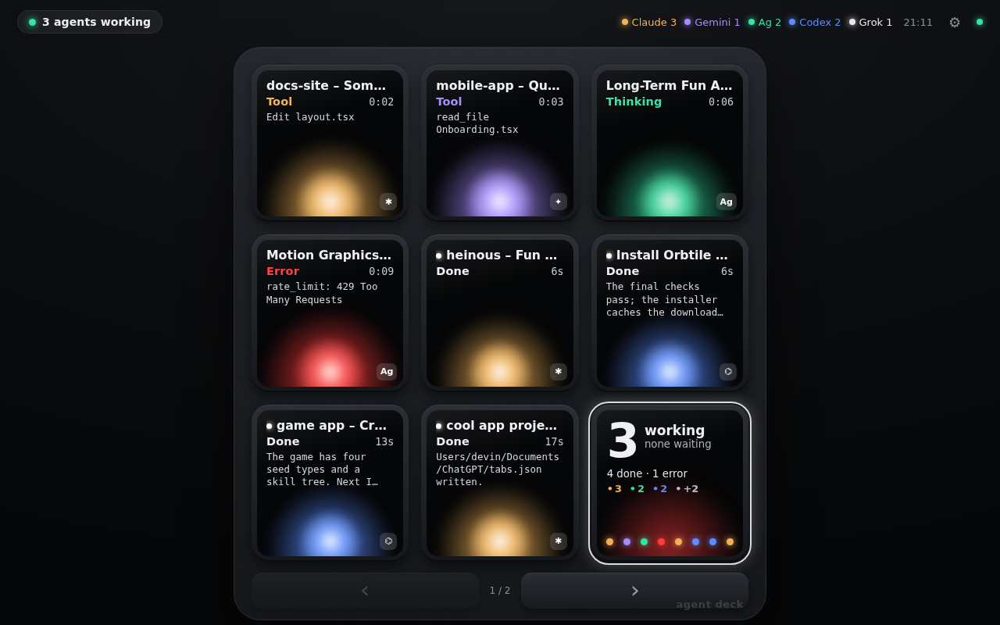

# Stream Deck Coding Agents

> Seus agentes de código no **Elgato Stream Deck**: uma tecla por sessão de Claude Code, Codex, Gemini CLI, Antigravity CLI ou herdr, com o mesmo visual dos tiles do Logitech MX Keypad (orbe colorido, estado, cronômetro, texto ao vivo). **Apertou a tecla, abre a janela daquela sessão.** Segurou, aprova o pedido de permissão. O mesmo painel também roda no navegador e no **Steam Deck**.



Zero dependências: Node 18+ no computador onde os agentes rodam. O plugin do Stream Deck usa o Node que o próprio app da Elgato já traz.

---

## Como funciona

```
 Claude Code ─┐  hooks (JSON por evento)   ┌──────────────────┐  SSE  ┌────────────────────────┐
 Codex CLI   ─┤ ─────────────────────────▶ │  agent-deck      │ ────▶ │ Stream Deck (plugin)   │  tecla = abre a janela
 Gemini CLI  ─┤                            │  serve  :7777    │ ◀──── │ Steam Deck / navegador │  segurar = Allow
 Antigravity ─┘                            │                  │ ações └────────────────────────┘
 herdr ◀──── socket ~/.config/herdr ──────▶│                  │
 adapters (Orbtile /a/v1) ────────────────▶└──────────────────┘ ──▶ foca o terminal / IDE da sessão
```

1. `agent-deck serve` roda no PC. Recebe os hooks, guarda o estado de cada sessão e serve a interface.
2. `agent-deck install all` grava os hooks nos arquivos de cada CLI (com backup e sem duplicar). Cada evento vira uma transição de estado. O hook também registra o **PID do processo do agente**: é com ele que o botão acha a janela certa.
3. O plugin do Stream Deck (ou o navegador / Steam Deck) assina o stream de eventos e desenha os tiles.
4. Apertar uma tecla manda `focus` para o servidor, que traz a janela da sessão para frente (Windows Terminal, VS Code, Terminal.app, iTerm2, X11…). Segurar 0,6 s em um tile **Approval** manda `allow`.

## Estados (iguais aos do keypad)

| Tile | `activity` | Dispara com |
| --- | --- | --- |
| **Starting** | `starting` | `SessionStart` |
| **Thinking** | `thinking` | prompt enviado, modelo pensando, entre ferramentas |
| **Tool** | `tool` | ferramenta rodando: `Bash  npm test`, `Read  index.ts`… |
| **Writing** | `streaming` | texto do assistente chegando (Claude `MessageDisplay`) |
| **Approval** | `waitingPermission` | `PermissionRequest`, `ToolPermission`, `permission_prompt` |
| **Question** | `waitingQuestion` | `AskUserQuestion`, `request_user_input`, `agent_needs_input` |
| **Compacting** | `compacting` | compactação de contexto; depois volta ao estado anterior |
| **Done** | `done` | `Stop` / `AfterAgent`; mostra a última linha da resposta |
| **Error** | `error` | `StopFailure`, erro de API, `terminationReason: error` |
| **Idle** | `idle` | esperando prompt (`idle_prompt`, `Interrupt`, 90 s após Done) |
| **Offline** | `offline` | adapter sem heartbeat ou TTL vencido |

Cores: cada agente tem cor de trabalho e cor de alarme (Claude âmbar/terracota, Codex azul/magenta, Antigravity verde/rosa, Gemini violeta/rosa, Grok branco/laranja); erro é vermelho. Ordem das teclas: **esperando você → trabalhando → terminou há < 15 s → done → idle → offline**, recalculada a cada 8 s. O tile **hub** mostra quantos trabalhando, quantos esperando (e qual), quantos done, contagem por agente e um pip por tecla.

## 1. Servidor (PC onde os agentes rodam)

```bash
git clone https://github.com/gabrielvaz/stream-deck-coding-agents
cd stream-deck-coding-agents
node bin/agent-deck.mjs serve        # deixe rodando (ou use steamdeck/agent-deck.service / agent-deck-server.bat)
```

Em outro terminal:

```bash
node bin/agent-deck.mjs install all  # claude codex gemini antigravity
node bin/agent-deck.mjs doctor       # confere hooks, socket do herdr e servidor
node bin/agent-deck.mjs demo         # sessões falsas para ver o painel sem configurar nada
```

Depois do `install`: no **Codex**, abra o codex e rode `/hooks` para revisar e confiar nos hooks. No **Gemini CLI**, se nada aparecer, `/hooks enable-all`.

## 2. Elgato Stream Deck

Requisitos: app Stream Deck 6.5 ou mais novo (Windows 10+ / macOS 12+). Nenhuma dependência extra.

```bash
node bin/agent-deck.mjs streamdeck install     # copia o plugin para a pasta do app
```

(No WSL o comando acha a pasta `%APPDATA%\Elgato\StreamDeck\Plugins` do Windows sozinho. Para desenvolver, `--link` cria um symlink.)

Feche e abra o app Stream Deck. Na categoria **Coding Agents** arraste para as teclas:

| Ação | Tecla mostra | Apertar | Segurar (0,6 s) |
| --- | --- | --- | --- |
| **Agent Session** | título, estado + tempo, detalhe, orbe, selo do agente | **abre a janela daquela sessão** | **Allow** se estiver em Approval; escolhe a 1ª opção se for Question; senão marca como lida |
| **Agents Hub** | N working / none waiting / N done / contagem por agente / pips | abre a janela da primeira sessão esperando você | próxima página |
| **Allow** / **Deny** | verde/vermelho com o nome da sessão pendente | responde o primeiro pedido de permissão | — |
| **Next Page** | página atual | avança 8 sessões | — |

Um layout comum num Stream Deck de 15 teclas: 8 × *Agent Session* (em **Auto** elas pegam os slots 1–8 pela posição da tecla), 1 × *Agents Hub*, *Allow*, *Deny*, *Next Page*. Em *Property Inspector* dá para fixar o slot de cada tecla e informar o servidor e o token quando o servidor não está na mesma máquina (ou está no WSL e o Stream Deck no Windows: use `http://127.0.0.1:7777` e cole o token de `agent-deck token`). Sem nada configurado, o plugin lê `~/.agent-deck/config.json`.

### O que "abrir a janela" faz em cada sistema

| Sistema | Como acha a janela | Observações |
| --- | --- | --- |
| Windows | sobe a árvore de processos a partir do PID do agente até achar uma janela (Windows Terminal, VS Code, cmd…) e chama `SetForegroundWindow`; se não achar, procura janela cujo título contenha o prompt, o projeto ou o nome do agente | funciona com Claude Code, Codex e Gemini rodando no PowerShell/cmd/Windows Terminal/VS Code |
| WSL | PID do WSL não enxerga janelas; usa a busca por título via `powershell.exe` (o Windows Terminal mostra o título que o Claude Code define) | se quiser exatidão, use `openCommand` (abaixo) |
| macOS | `tty` do agente → aba exata no **Terminal.app** ou **iTerm2**; senão `System Events` traz para frente o app ancestral (VS Code, Warp…) | pode pedir permissão de Automação/Acessibilidade na primeira vez |
| Linux (X11) | `xdotool search --pid` na árvore de processos, depois por título | instale `xdotool`; Wayland precisa de `openCommand` |
| herdr | `herdr agent focus <pane>` | foca o pane exato |
| adapters Orbtile | `openURL` da sessão + evento `tap` | |

Para forçar um comando próprio (por exemplo abrir o Juspilot/OpenBot, o VS Code na pasta, ou um `wt focus-tab`):

```json
{ "openCommand": "code --reuse-window \"{cwd}\"" }
```

ou por agente: `"agents": { "codex": { "openCommand": "wt -w 0 nt -d \"{cwd}\"" } }`. Placeholders: `{cwd} {project} {title} {pid} {sessionId} {agent}`.

## 3. Navegador e Steam Deck

`agent-deck serve` imprime a URL já com o token (`http://IP:7777/#k=…`). Abra em qualquer navegador para ter o painel 3×3 da captura acima (touch, teclado e gamepad).

No **Steam Deck** (Desktop Mode → Konsole):

```bash
bash steamdeck/install-on-deck.sh "http://192.168.1.20:7777/#k=SEU_TOKEN"
```

O script instala o Chromium (flatpak) se preciso, cria o launcher kiosk 1280×800 e explica como adicioná-lo como jogo não-Steam. Controles: D-pad/analógico move, **A** abre, **segurar A** aprova, **B** nega/volta, **X** marca lido, **Y** abre a janela no PC, **LB/RB** páginas.

## Aprovar de longe, por agente

| Agente | Estado | Allow / Deny | Como |
| --- | --- | --- | --- |
| Claude Code | ✔ | ✔ | o hook `PermissionRequest` fica aberto até `approvalHoldSeconds` (20 s) **só enquanto um painel/plugin está conectado**; sua decisão volta pelo hook, senão o prompt do terminal aparece normalmente |
| Codex CLI | ✔ | ✔ | mesmo mecanismo via `~/.codex/hooks.json` |
| Gemini CLI | ✔ | — | `Notification: ToolPermission` é só observabilidade; aperte a tecla para abrir a janela e responder |
| Antigravity CLI | ✔ | — | hooks em `~/.gemini/config/hooks.json`; `PreToolUse` responde `{"decision":"allow"}` (delega à política do agy) |
| herdr | ✔ | ✔ | status pelo socket; Allow/Deny = `herdr agent send-keys` (`enter`/`esc`, configurável) |
| Adapters | ✔ | ✔ | fila `POST /a/v1/adapters/{id}/events` (protocolo v1.1) |

A decisão nunca é executada pelo painel: ela é entregue ao hook que está esperando ou enviada como tecla ao terminal. O diálogo do agente continua sendo a autoridade.

## Configuração (`~/.agent-deck/config.json`)

```json
{
  "port": 7777,
  "host": "0.0.0.0",
  "token": "…",
  "requireToken": true,
  "approvalHoldSeconds": 20,
  "doneToIdleSeconds": 90,
  "idleKeepMinutes": 120,
  "openCommand": null,
  "herdr": { "enabled": true, "socketPath": null, "hideAgents": "auto", "keys": { "allow": ["enter"], "deny": ["esc"] } },
  "agents": { "claude": { "name": "Claude", "color": "#F3B257", "alarm": "#E2714B", "openCommand": null } },
  "installed": ["claude", "codex"]
}
```

- `herdr.hideAgents: "auto"` esconde no herdr os agentes que já têm hook (evita tile duplicado).
- `requireToken: false` ou `serve --no-token` em rede confiável.
- Env: `AGENT_DECK_HOME`, `AGENT_DECK_PORT`, `AGENT_DECK_HOST`, `AGENT_DECK_TOKEN`, `AGENT_DECK_SERVER` (host que o hook chama), `AGENT_DECK_HOST_ALIAS` (sessão remota, aparece com 🌐).
- Hooks por projeto: `agent-deck install claude --project ./repo`. `agent-deck uninstall …` remove só as entradas do Agent Deck.

### Servidor no WSL, Stream Deck no Windows

Rode `serve` e `install` dentro do WSL (onde os agentes rodam). No plugin, informe `http://127.0.0.1:7777` e o token (`agent-deck token` no WSL). O botão "abrir janela" usa `powershell.exe` por título; para precisão total, configure `openCommand` com `wt.exe` ou `code`.

## O que o instalador escreve

| Agente | Arquivo | Eventos |
| --- | --- | --- |
| Claude Code | `~/.claude/settings.json` → `hooks` | `SessionStart`, `UserPromptSubmit`, `PreToolUse`, `PostToolUse`, `PostToolUseFailure`, `PermissionRequest`, `Notification`, `MessageDisplay` (hook `http`), `SubagentStart/Stop`, `Stop`, `StopFailure`, `PreCompact`, `PostCompact`, `SessionEnd` (os de observação com `async: true`) |
| Codex CLI | `~/.codex/hooks.json` | `SessionStart`, `UserPromptSubmit`, `PreToolUse`, `PermissionRequest`, `PostToolUse`, `PreCompact`, `PostCompact`, `SubagentStart/Stop`, `Stop`, `Interrupt`, `SessionEnd` |
| Gemini CLI | `~/.gemini/settings.json` → `hooks` (+ `tools.enableHooks`) | `SessionStart`, `SessionEnd`, `BeforeAgent`, `AfterAgent`, `BeforeTool`, `AfterTool`, `Notification`, `PreCompress` |
| Antigravity CLI | `~/.gemini/config/hooks.json` → `"agent-deck"` | `SessionStart`, `PreInvocation`, `PostInvocation`, `PreToolUse`, `PostToolUse`, `Stop` (nome do evento vai como argumento) |

Todos chamam `hooks/agent-deck-hook.mjs <agente> [evento]`: lê o JSON do stdin, faz `POST http://127.0.0.1:7777/api/v1/hook/<agente>?pid=<pid do agente>` e devolve a resposta. Servidor desligado = resposta neutra e exit 0; o agente nunca trava.

## API

Token obrigatório (`?k=`, `Authorization: Bearer` ou `X-Agent-Deck-Token`), exceto `/api/v1/hook/*` vindo de loopback.

| Método | Rota | Para quê |
| --- | --- | --- |
| `GET` | `/api/v1/state` | snapshot (sessões ordenadas, resumo, paleta) |
| `GET` | `/api/v1/events` | Server-Sent Events, um snapshot por mudança |
| `POST` | `/api/v1/hook/:agent?event=&pid=` | entrada dos hooks |
| `POST` | `/api/v1/sessions/:uid/actions` | `{"action":"focus"|"allow"|"deny"|"dismiss"|"answer"|"read"|"remove"}` |
| `POST` | `/api/v1/sessions` | API simples: `{"agent":"custom","id":"job-1","title":"Deploy","activity":"tool","toolLabel":"Deploy  web"}` |
| `*` | `/a/v1/…` | Adapter Protocol v1.1 compatível com [Orbtile](https://github.com/Orbtile/orbtile-adapters) (`PUT /adapters/{id}`, `POST …/sessions/{sid}`, `heartbeat`, `events`, `GET /info` com prova HMAC) |

Descoberta: `~/.agent-deck/adapter-api.json` (`url`, `socketPath`, `basePath`, `token`). Os adapters de referência do Orbtile rodam sem alteração com `ORBTILE_API_FILE=~/.agent-deck/adapter-api.json`.

## Comandos

```
agent-deck serve [--port N] [--host A] [--no-token] [--no-herdr] [--demo]
agent-deck demo
agent-deck install <claude|codex|gemini|antigravity|all> [--project DIR] [--no-live-text]
agent-deck uninstall <…>
agent-deck streamdeck install [--link] | uninstall
agent-deck status · token [--rotate] · url · doctor
```

## Desenvolvimento

```bash
npm test                      # scripts/agent-deck-e2e.mjs: servidor real, hooks reais, SSE, aprovação segurada, focus, Adapter API → .build/agent-deck-e2e.json
npm run demo                  # servidor com sessões falsas
npm run screenshot            # docs/*.png via Playwright (PLAYWRIGHT_DIR opcional)
node streamdeck/make-icons.mjs   # regenera os PNGs do plugin
```

```
bin/agent-deck.mjs            CLI
src/server.mjs                HTTP + SSE + hooks + Adapter API
src/store.mjs                 estado das sessões, tiers, ações, decisões pendentes
src/focus.mjs                 "abrir a janela": Windows / WSL / macOS / Linux / openCommand
src/mappers/*.mjs             evento de cada CLI → estado do tile
src/herdr.mjs                 socket do herdr + ações via CLI
src/install.mjs               instaladores de hooks
src/streamdeck.mjs            instalador do plugin
hooks/agent-deck-hook.mjs     script universal chamado pelos agentes
streamdeck/com.gabrielvaz.coding-agents.sdPlugin/   plugin Elgato (manifest, bin/plugin.mjs, pi/, imgs/)
web/                          painel do navegador / Steam Deck (HTML/CSS/JS puro)
steamdeck/                    instalador kiosk, ícone, service/bat do servidor
```

O plugin fala o protocolo WebSocket do Stream Deck direto (cliente RFC 6455 mínimo) e desenha cada tecla como SVG, então não há build nem `node_modules`.

## Créditos

- [Orbtile](https://orbtile.com) e seu [Adapter Protocol](https://github.com/Orbtile/orbtile-adapters) (MIT), que inspiraram os estados, a ordenação e a API compatível. [Logitech MX Keypad](https://www.logitech.com/en-us/shop/p/mx-keypad).
- Hooks: [Claude Code](https://code.claude.com/docs/en/hooks), [Codex CLI](https://developers.openai.com/codex/hooks), [Gemini CLI](https://geminicli.com/docs/hooks/), [Antigravity CLI](https://antigravity.google/docs/hooks), [herdr](https://herdr.dev/tui/docs/socket-api/). [Stream Deck SDK](https://docs.elgato.com/streamdeck/sdk/).
- Relacionados: [eyes-on-claude-code](https://github.com/joe-re/eyes-on-claude-code), [claude-code-monitor](https://github.com/bruceyxli/claude-code-monitor), [keyvo](https://github.com/qubernetic/keyvo).

MIT © Gabriel Vaz
