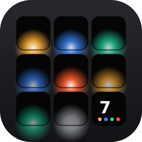
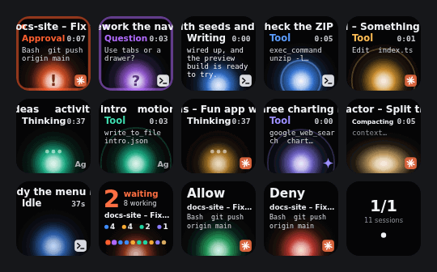
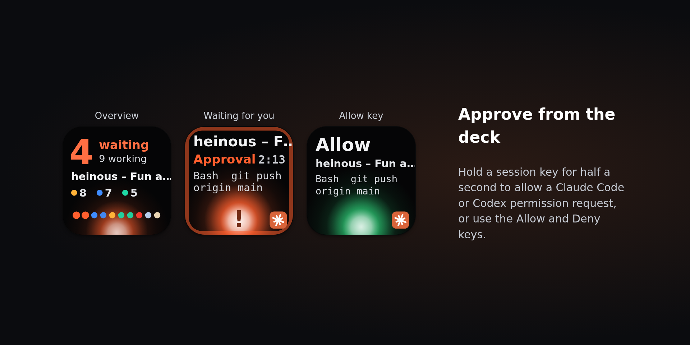
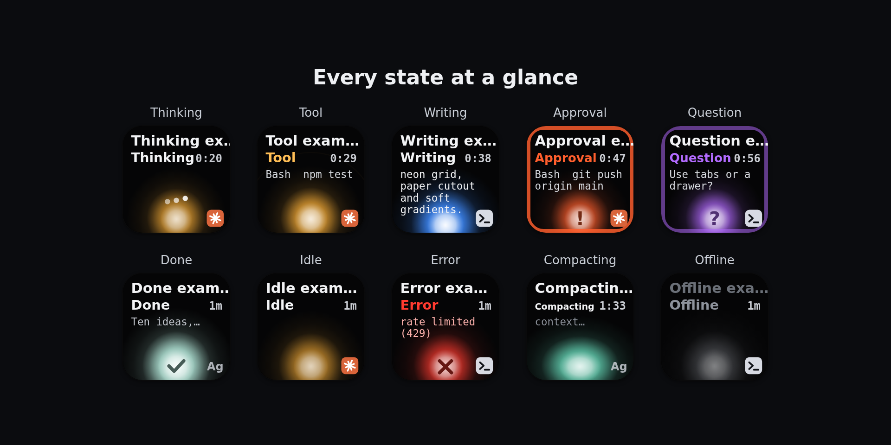
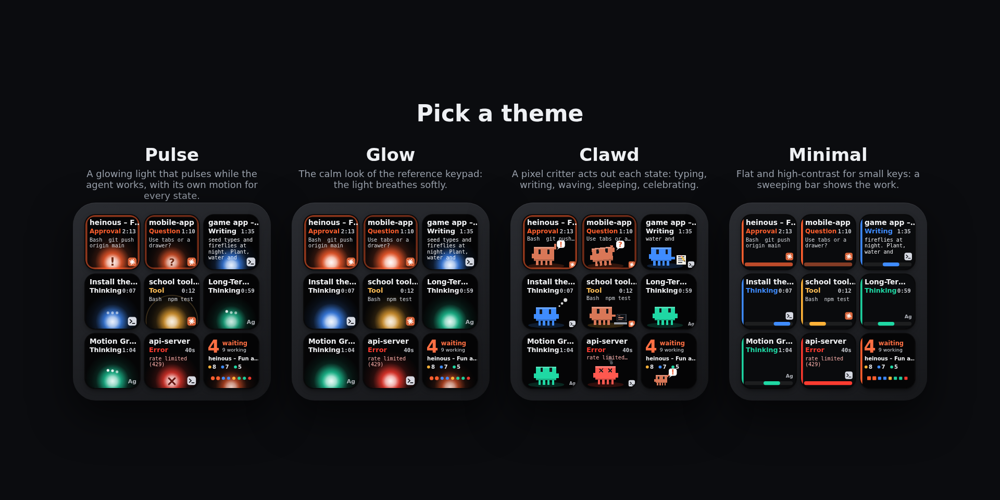
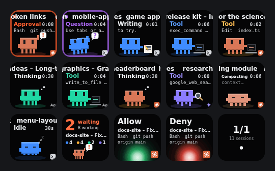
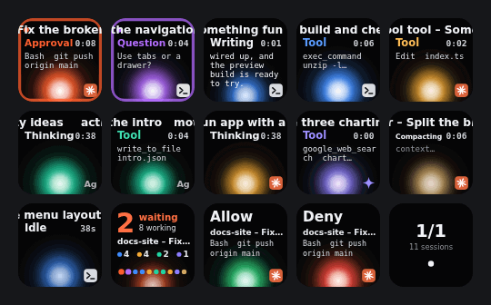
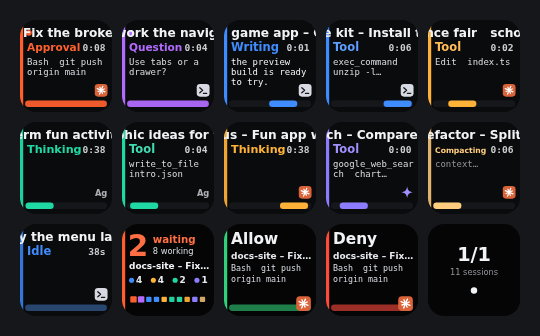
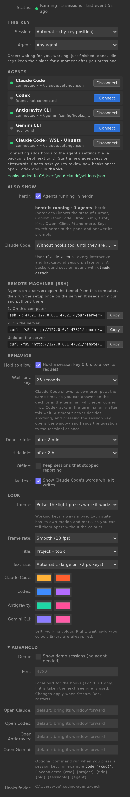

<div align="center">



# Coding Agents for Stream Deck

**Your AI coding agents, live on your Elgato Stream Deck.**<br />
One key per Claude Code, Codex, Antigravity or Gemini session: its state, timer, the tool it runs and the words it writes.<br />
**Press to jump to it. Hold to approve.**

Windows · macOS · WSL · SSH remotes &nbsp;|&nbsp; Stream Deck 7.1+ &nbsp;|&nbsp; Free and open source (MIT) &nbsp;|&nbsp; Nothing leaves your computer

[Website](https://gabrielvaz.github.io/stream-deck-coding-agents/) · [Download](https://github.com/gabrielvaz/stream-deck-coding-agents/releases/latest) · [Install](#install) · [Compatibility](#compatibility) · [Themes](#themes) · [FAQ](#troubleshooting) · [Português](#em-português)



</div>

---

## Contents

- [What it does](#what-it-does)
- [Install](#install)
- [Keys](#keys)
- [States](#states)
- [Themes](#themes)
- [Compatibility](#compatibility)
- [Connecting each agent](#connecting-each-agent)
- [Approving from the deck](#approving-from-the-deck)
- [Jumping to the window](#jumping-to-the-window)
- [herdr, background sessions and remote machines](#herdr-background-sessions-and-remote-machines)
- [Settings](#settings)
- [Privacy and security](#privacy-and-security)
- [Troubleshooting](#troubleshooting)
- [How it works](#how-it-works)
- [Development](#development)
- [Publishing to the Elgato Marketplace](#publishing-to-the-elgato-marketplace)
- [Em português](#em-português)

## What it does

Running several coding agents at once means constantly checking terminals to see who finished, who is stuck and who needs a "yes". This plugin puts that on your Stream Deck:

- **Every session is a live key.** Each key shows the session's title, its state with a timer, the tool it is running (`Bash  npm test`), the words it is writing, and a light or a little critter that moves while it works.
- **The deck sorts itself.** Sessions waiting for you come first, then working ones, then those that just finished. Keys hold still for a moment after you press one, so nothing moves under your finger.
- **Press a key to jump to that session.** It brings up the right Windows Terminal tab, VS Code window, Terminal.app or iTerm2 tab, or herdr pane.
- **Hold a key to approve.** Claude Code and Codex permission requests show the exact command; hold the key (a green bar fills) or use the Allow and Deny keys.
- **Setup takes one click per agent.** The plugin installs its own hooks, uses Stream Deck's built-in Node.js, and runs entirely on your computer.



## Install

1. **Get the plugin.** Download `com.gabrielvaz.coding-agents.streamDeckPlugin` from the [latest release](https://github.com/gabrielvaz/stream-deck-coding-agents/releases/latest) and double-click it, or install it from the Elgato Marketplace. You need the Stream Deck app 7.1 or later on Windows 10+ or macOS 12+.
2. **Place keys.** From the **Coding Agents** category, drag one **Agents Overview** key and as many **Agent Session** keys as you like. **Allow**, **Deny** and **Next Page** are optional.
3. **Connect your agents.** Select any of those keys. In its settings, press **Connect** next to each agent you use.
4. **Start a new agent session.** Its key lights up.

> No agents yet? Open a key's settings, then **Advanced → Demo** shows a full deck of fake sessions.

## Keys

| Action | The key shows | Press | Hold (0.6 s) |
| --- | --- | --- | --- |
| **Agent Session** | title (scrolls), state and timer, tool / live text / question / last line, the theme's animation, agent badge | open the session's window | **allow** its pending request; on a finished session, mark it as seen |
| **Agents Overview** | `6 working`, `none waiting` or `2 waiting` and who, `3 done`, a count per agent, one pip per session | open the first session waiting for you | next page |
| **Allow** / **Deny** | lit with the session and the command whenever a request can be answered | answer the oldest request | — |
| **Next Page** | page and number of sessions | next page | back to page 1 |

In **Automatic** mode, session keys fill by position (left to right, top to bottom) on each device. A key can also be pinned to "the 3rd session" or to one agent only (e.g. *Codex only*), so you can give each agent its own row.

## States



| State | When | Pulse theme | Clawd theme |
| --- | --- | --- | --- |
| **Thinking** | prompt sent, model working | slow pulse, bouncing dots | bobs, looks around, thought bubbles |
| **Tool** | a tool runs: `Bash  npm test`, `Edit  index.ts`… | beat with a radar ring | types on a laptop (or searches with a magnifier) |
| **Writing** | the answer streams; Claude Code shows the words live | quick flutter | scribbles on paper |
| **Approval** | a tool needs your permission | double beat with `!`, pulsing border | waves with a `!` bubble |
| **Question** | the agent asked you something | double beat with `?`, pulsing border | tilts its head with a `?` bubble |
| **Done** | finished; shows the last line | still, pale, check mark, white dot until seen | jumps with confetti, then grins |
| **Idle** | waiting for a prompt | faint slow breath | sleeps, `z z z` |
| **Error** | API error, rate limit… | red throb with `×` | X eyes, smoke |
| **Compacting** | summarising a long context | squeeze | gets squished |
| **Offline** | stopped reporting (hidden by default) | grey, still | a translucent ghost |

Working keys always move, and each state has its own motion and mark, so the deck reads without relying on colour.

## Themes

Pick one in any key's settings → **Look → Theme**.



| Pulse (default) | Clawd |
| --- | --- |
|  |  |
| A glowing light that pulses while the agent works, with its own motion for every state. | A pixel critter acts out each state. Claude Code sessions are terracotta; other agents get the critter in their own colour. |
| **Glow** | **Minimal** |
|  |  |
| The calm look of the reference keypad: the light breathes softly. | Flat and high-contrast for small keys: a bar sweeps while it works and blinks while it waits. |

Colours per agent (working and waiting-for-you) are configurable; errors are always red. On 72 px keys (Stream Deck MK.2, Mini) the text gets larger automatically.

## Compatibility

| Agent | Live state | Approve from the deck | How it connects |
| --- | :-: | :-: | --- |
| **Claude Code**: terminal, IDE extensions, Remote Control, background sessions (`claude --bg`) | ✅ | ✅ | hooks in `~/.claude/settings.json`; every running session is also listed by `claude agents`, even before you connect |
| **OpenAI Codex CLI** | ✅ | ✅ | hooks in `~/.codex/hooks.json`; trust them once with `/hooks` |
| **Google Antigravity CLI** (`agy`) | ✅ | in its window | hooks in `~/.gemini/config/hooks.json`, plus its window-title command, which is where it reports a pending confirmation |
| **Gemini CLI** | ✅ | in its window | hooks in `~/.gemini/settings.json` (Gemini hooks cannot answer prompts) |
| **Agents in [herdr](https://herdr.dev)**: Cursor, Copilot, OpenCode, Droid, Amp, Grok, Kiro, Qwen, Cline, Pi, Devin, Kimi and every other herdr agent kind | state | ✅ (Enter / Esc) | reads `herdr agent list`; focuses with `herdr agent focus`; answers with `herdr agent send-keys` |
| **Any of the above inside WSL** (Windows) | ✅ | ✅ (Claude Code, Codex) | its own *Connect* row per running distro; hooks reach Stream Deck through WSL interop |
| **Any of the above on a server over SSH** | ✅ | ✅ (Claude Code, Codex) | an `ssh -R` tunnel plus a curl-only setup script the plugin generates |
| **Claude Code on the web** (cloud sessions) | — | — | runs on Anthropic's servers and can't reach your computer; `claude --teleport` brings a session to your terminal, where it shows up |
| **Your own scripts** | ✅ | — | `POST /api/v1/sessions` on the local API |

Requirements: Claude Code 2.1.139 or later (2.1.214+ for exact window focus), herdr 0.9 or later.

## Connecting each agent

Press **Connect** in a key's settings. Each connection adds entries tagged `.coding-agents-deck` to that agent's settings file, keeps a backup next to it (`*.coding-agents-deck.bak`), and is undone by **Disconnect**, which removes only those entries.

| Agent | File | Notes |
| --- | --- | --- |
| Claude Code | `~/.claude/settings.json` | Runs Stream Deck's Node.js directly (exec form, no shell). Observation hooks are `async`, so Claude never waits for them. Running sessions usually pick them up; new sessions always do. |
| Codex | `~/.codex/hooks.json` | Codex asks you to review new hooks: open Codex, run `/hooks` and trust the *Coding Agents* entries. The command is a stable launcher path, so the trust survives plugin and Stream Deck updates. |
| Antigravity CLI | `~/.gemini/config/hooks.json` and `title` in `~/.gemini/antigravity-cli/settings.json` | The window title then shows the conversation name. If you already have a title command, it is left alone and only the hooks are added. |
| Gemini CLI | `~/.gemini/settings.json` | Comments in the file are tolerated. |

## Approving from the deck

Claude Code and Codex send a `PermissionRequest` hook before they ask you. The plugin holds that request and shows it on the session key and the Allow / Deny keys, with the tool and the command.

- **Hold** the session key (a green bar fills along the bottom) or press **Allow** to approve, or press **Deny** to refuse. The decision goes back through the hook.
- **Claude Code** keeps showing its own prompt in the terminal at the same time; whichever answers first wins.
- **Codex** waits for the deck for the time set in *Wait for a key* (25 s by default), then asks in the terminal.
- A **short press** on the key opens the window and hands the question back to the terminal immediately.
- **A timeout never decides anything.** If nobody answers on the deck, the agent simply asks as usual.
- **herdr sessions** are answered by pressing Enter (accept) or Esc (cancel) in their pane.

## Jumping to the window

| | How the plugin finds the window |
| --- | --- |
| **Windows** | Walks up the agent's process tree to the window that hosts it: Windows Terminal (and the matching tab), VS Code, Cursor or a classic console. For terminals that are not a parent of the agent (ConPTY, WSL), it uses the window that owns the agent's console. It never focuses the desktop shell, and as a last resort it looks for a window whose title mentions the session. |
| **macOS** | The exact Terminal.app or iTerm2 tab, matched by the agent's tty. Otherwise the app that hosts the agent (VS Code, Cursor, Warp, Ghostty, WezTerm…) and its window for the project. macOS asks once to allow Stream Deck to control Terminal / System Events. |
| **herdr** | Switches herdr to the session's pane, then brings the terminal showing herdr forward. |
| **Background sessions** | Opens a new terminal with `claude attach <session>`. |
| **Your own command** | *Advanced → Open Claude/Codex/…*, e.g. `code "{cwd}"`. Placeholders: `{cwd} {project} {title} {pid} {sessionId} {agent}`. |

## herdr, background sessions and remote machines

**[herdr](https://herdr.dev)** is a terminal workspace for coding agents that detects about two dozen agent kinds. With *Also show → herdr* on (the default), every agent herdr knows appears on the deck, a press switches herdr to its pane, and Allow / Deny press Enter or Esc there. Agents that also report through this plugin's hooks are shown once, with the richer hook data, and still jump to the right herdr pane.

**`claude agents`** lists every running Claude Code session on the computer, interactive or background. By default (*Also show → Claude Code: without hooks too*) the deck lists them until you connect Claude Code's hooks, so you see something before any setup. Background sessions (`claude --bg`) open in a new terminal with `claude attach`.

**Remote machines (SSH).** The plugin's endpoint listens on `127.0.0.1` only. An SSH reverse tunnel makes it reachable from a server, and a setup script, served by the plugin through that tunnel, connects the agents there with plain `curl` hooks. The exact commands, with your port and a long-lived remote token, are in the key settings under **Remote machines (SSH)**:

```bash
# 1. on this computer
ssh -R 47821:127.0.0.1:47821 my-server
# 2. on the server, once (needs curl and python3; backs up the files it changes)
curl -fsS "http://127.0.0.1:47821/remote/setup.sh?k=<token>" | sh
```

Remote sessions show the server's name in front of the project. When the tunnel is closed the hooks answer neutrally in a fraction of a second. To undo, run the *Undo on the server* command.

## Settings



All settings live in any key's settings and are shared by every key.

| Section | Setting | Default |
| --- | --- | --- |
| This key | Session: automatic by position, or the *n*-th session · Agent: any, or one agent only | Automatic · any |
| Agents | Connect / Disconnect per agent, also per WSL distro | — |
| Also show | herdr agents · Claude Code sessions without hooks | on · until hooks are connected |
| Remote machines | tunnel, setup and undo commands to copy | — |
| Behavior | Hold to allow · Wait for a key (Codex) · Done → Idle · Hide idle · Keep offline sessions · Live text from Claude Code | on · 25 s · 2 min · 2 h · off · on |
| Look | Theme · Frame rate (10 or 4 fps) · Title (project – topic, topic, folder) · Text size · colours per agent | Pulse · 10 fps · project – topic · automatic |
| Advanced | Demo · Port · Open command per agent | off · 47821 · window focus |

## Privacy and security

- **Local only.** The endpoint listens on `127.0.0.1`, requires a random token stored in `~/.coding-agents-deck/endpoint.json` (readable only by your account; a new token each time Stream Deck starts), and rejects browser requests. Remote machines use a separate long-lived token kept in the plugin settings.
- **No data collection.** No account, no analytics, no network calls. Session data stays in memory and is discarded when Stream Deck quits. Read the [privacy policy](marketplace/PRIVACY.md).
- **Explicit changes only.** Agent settings are changed only when you press Connect, with backups, and Disconnect restores everything else as it was.
- **The agent stays in charge.** Decisions are delivered to the hook that asked, or typed as keys in herdr; the agent's own permission rules still apply.

## Troubleshooting

<details><summary><b>A connected agent does not show up</b></summary>

Start a new session of the agent after connecting; running sessions may not reload hooks. For Codex, run `/hooks` and trust the new entries. Check the status line at the top of the key settings: it shows when the last event arrived.
</details>

<details><summary><b>Pressing a key does not bring the window forward</b></summary>

- **macOS:** allow Stream Deck under *System Settings → Privacy & Security → Automation* (Terminal, iTerm2, System Events) and *Accessibility*.
- **Windows:** an elevated (administrator) terminal cannot be focused by a normal app. Run Stream Deck elevated too, or set an *Open command*.
</details>

<details><summary><b>Agents in WSL</b></summary>

Start the distro (open a WSL terminal), then open the key settings: a row such as *Claude Code · WSL · Ubuntu* appears for each agent used inside it.
</details>

<details><summary><b>The port is taken</b></summary>

The plugin uses the next free port automatically and the hooks find it through `endpoint.json`. To pin a port, set *Advanced → Port* and restart Stream Deck.
</details>

<details><summary><b>Uninstalling</b></summary>

Press *Disconnect* for each agent first; then remove the plugin in Stream Deck. Leftover hooks are harmless: they answer neutrally when the plugin is gone, but Disconnect removes them cleanly.
</details>

## How it works

```
 Claude Code ─┐   hook.mjs (Stream Deck's Node.js)        ┌──────────────────────────────┐
 Codex       ─┤ ───────────── POST 127.0.0.1 ───────────▶ │ Coding Agents plugin          │
 Antigravity ─┤ ◀──────── decision / window title ─────── │  session store → key tiles    │ ──▶ Stream Deck keys
 Gemini CLI  ─┘                                           │  window focus (PowerShell/AS) │
 herdr ─────────── herdr agent list / focus / send-keys ─▶ │  herdr + claude agents        │
 claude agents ─── claude agents --json ────────────────▶ │                               │
 SSH server ────── curl through ssh -R ─────────────────▶ └──────────────────────────────┘
```

1. At start the plugin listens on `127.0.0.1:47821` (or the next free port) and writes `~/.coding-agents-deck/` with the hook client (`hook.mjs`), a small launcher (`hook` / `hook.cmd`) and `endpoint.json`.
2. *Connect* adds hook entries to the agent's settings. Each event becomes a state change on a key. If Stream Deck is not running, the hook answers neutrally and exits in milliseconds, so your agent never waits.
3. Keys are SVG drawn at up to 10 frames per second and only re-sent when they change.

### Local API

For your own tools (token in `~/.coding-agents-deck/endpoint.json`):

```bash
curl -s -X POST "http://127.0.0.1:47821/api/v1/sessions" \
  -H "Authorization: Bearer $TOKEN" -H "Content-Type: application/json" \
  -d '{"id":"deploy-1","title":"Deploy web","activity":"tool","toolLabel":"Deploy  web","ttlSeconds":300}'
```

`activity` is one of `thinking tool writing approval question done error idle offline`. `GET /api/v1/state` returns every session; `{"id":"deploy-1","remove":true}` removes one.

## Development

```bash
npm install
npm run build       # bundle src/ into com.gabrielvaz.coding-agents.sdPlugin/bin/
npm run link        # link the plugin into Stream Deck (developer mode) — then `npm run watch`
npm test            # unit tests + end-to-end tests with a simulated Stream Deck
npm run validate    # Elgato's validator
npm run pack        # dist/com.gabrielvaz.coding-agents.streamDeckPlugin
npm run assets      # icons and default key images        (needs Playwright, PLAYWRIGHT_DIR=…)
npm run gallery     # docs/ images + the setup-page screenshot
npm run gifs        # docs/deck-<theme>.gif
npm run site        # docs/assets/deck.js for the website (docs/index.html)
```

The end-to-end tests run the real plugin bundle under `scripts/sim.mjs`, a stand-in for the Stream Deck app that speaks its WebSocket protocol. They connect every agent in a throw-away home folder, run the hook client the way each CLI does, drive herdr and `claude agents` through fake executables, and set up an "SSH" machine with the generated script. Live checks against the real tools:

- `node scripts/try-claude.mjs`: real Claude Code (`claude -p`, one tiny Haiku call), approved from a simulated key.
- `node scripts/windows-smoke.mjs` (from WSL): the plugin under Windows Node.js. Codex runs through PowerShell, Claude Code in exec form and Antigravity through `cmd /c`, all in a profile path with a space.
- `node scripts/wsl-claude.mjs` (from WSL): the plugin on Windows, real Claude Code in WSL.

```
src/plugin.ts            entry: registers the actions, starts the deck
src/deck.ts              keys, layout, pages, presses, answers, frame loop
src/actions.ts           Stream Deck actions and setup-page messages
src/core/server.ts       local endpoint (127.0.0.1 + token), remote setup script
src/core/mappers.ts      hook events of each CLI → session state
src/core/store.ts        sessions, ordering, pending decisions
src/core/installer.ts    connect / disconnect / status per agent (native and WSL)
src/core/discovery.ts    herdr and `claude agents`
src/core/remote.ts       SSH setup script
src/core/focus.ts        open the session window (Windows via powershell.ts, macOS via osascript)
src/render/              kit.ts (shared), theme-orb.ts (Pulse, Glow), theme-clawd.ts, theme-minimal.ts, tiles.ts
src/hook/hook.mjs        the hook client the agents run (no dependencies)
src/web/landing.ts       the website's live deck
com.gabrielvaz.coding-agents.sdPlugin/   manifest, icons, setup page (ui/)
docs/                    website (index.html), images and GIFs
marketplace/             listing text, privacy policy, gallery, icon, checklist
ci/ci.yml                GitHub Actions workflow (move to .github/workflows/ to enable)
```

## Publishing to the Elgato Marketplace

Everything Maker Console asks for is in [`marketplace/`](marketplace/): listing text within Elgato's limits, the [privacy policy](marketplace/PRIVACY.md), the 288 px app icon, four 1920×960 gallery images and a [pre-submission checklist](marketplace/LISTING.md#before-submitting). Run `npm run pack`, then upload `dist/com.gabrielvaz.coding-agents.streamDeckPlugin`.

## Em português

**Coding Agents** é um plugin para o Elgato Stream Deck que mostra cada sessão de Claude Code, Codex, Antigravity CLI e Gemini CLI numa tecla viva: estado com cronômetro, a ferramenta que está rodando, o texto sendo escrito e uma animação que se mexe enquanto o agente trabalha. **Apertar abre a janela da sessão; segurar aprova o pedido de permissão.**

- **Instalação:** dois cliques no `.streamDeckPlugin` da [release](https://github.com/gabrielvaz/stream-deck-coding-agents/releases/latest). Depois arraste *Agents Overview* e algumas *Agent Session* para o Stream Deck, abra as configurações de uma tecla e clique em **Connect** em cada agente (no Codex, rode `/hooks` uma vez para confiar nos hooks).
- **Temas:** Pulse (padrão, a luz pulsa enquanto trabalha), Glow, Clawd (um mascote em pixel art que digita, escreve, acena, dorme e comemora) e Minimal.
- **Compatibilidade:** Windows, macOS, agentes dentro do WSL e servidores via SSH. Pelo herdr, também Cursor, Copilot, OpenCode, Droid, Amp, Grok, Kiro, Qwen, Cline, Pi e outros. Sessões em segundo plano do Claude Code aparecem pelo `claude agents`.
- **Privacidade:** tudo roda no seu computador, sem conta e sem telemetria. Não precisa de Node.js instalado, porque usa o runtime do próprio Stream Deck.

## Credits

Design reference: the agent status pad on the Logitech MX Creative Keypad ([Orbtile](https://orbtile.com)). Hook documentation: [Claude Code](https://code.claude.com/docs/en/hooks), [Codex](https://learn.chatgpt.com/docs/hooks), [Antigravity](https://antigravity.google/docs/hooks), [Gemini CLI](https://github.com/google-gemini/gemini-cli/blob/main/docs/hooks/reference.md), [herdr](https://herdr.dev). Built with the [Stream Deck SDK](https://docs.elgato.com/streamdeck/sdk/) and [sdpi-components](https://sdpi-components.dev). Not affiliated with Anthropic, OpenAI, Google, Elgato, Logitech or herdr; product names and mascots belong to their owners.

MIT © Gabriel Vaz
