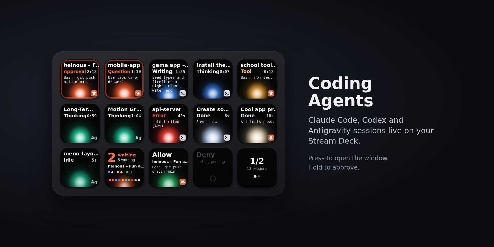

# Coding Agents for Stream Deck

Live keys for your AI coding agents on the **Elgato Stream Deck**: **Claude Code**, **OpenAI Codex**, **Google Antigravity CLI** and **Gemini CLI**. Each key is one session: its title, state, timer, current tool or the words it is writing, and a glowing orb that breathes while the agent works. **Press a key to jump to that session's window. Hold it to approve a permission request.**

Inspired by the agent status pad shown on the Logitech MX Creative Keypad, rebuilt from scratch as a Stream Deck plugin for Windows and macOS.



| | |
| --- | --- |
|  |  |

- **Zero setup outside Stream Deck.** The plugin runs its own local endpoint and uses Stream Deck's built-in Node.js. You do not need Node.js, a server or a terminal command.
- **One click per agent.** In the key settings, press *Connect* next to each agent. The plugin adds its hooks to that agent's settings file, keeps a backup, and removes only its own entries when you disconnect.
- **Windows, macOS and WSL.** On Windows it also finds agents running inside WSL distributions.
- **Private by design.** Everything stays on your computer (127.0.0.1, token-protected). No account, no telemetry.

## Keys

| Action | The key shows | Press | Hold (0.6 s) |
| --- | --- | --- | --- |
| **Agent Session** | title (scrolls), state + timer, tool / streamed text / question / last line, orb, agent badge | open the session's terminal or editor window | **Allow** the pending permission request; on a finished session, mark it as seen |
| **Agents Overview** | `6 working`, `none waiting` or `2 waiting` + who, `3 done`, a count per agent, one pip per key | open the first session that is waiting for you | next page |
| **Allow** / **Deny** | lit with the session and command when a request can be answered | answer the oldest request | — |
| **Next Page** | page and session count | next page of sessions | back to page 1 |

Put as many *Agent Session* keys as you like. In *Automatic* mode they fill by position (left to right, top to bottom); a key can also be pinned to "the 3rd session" or to one agent only. Sessions are ordered like the reference keypad: **waiting for you → working → just finished → done → idle**, re-sorted every few seconds and frozen for a moment after you press a key, so nothing moves under your finger.

### States

| State | When | Orb |
| --- | --- | --- |
| Thinking | prompt sent, model working | agent colour, breathing |
| Tool | a tool runs: `Bash  npm test`, `Edit  index.ts`… | agent colour |
| Writing | the answer is streaming (Claude Code shows the words live) | agent colour, quicker |
| Approval | a tool needs your permission | alert colour, pulsing border |
| Question | the agent asked you something | alert colour, pulsing border |
| Done | finished; shows the last line | pale, still, white dot until seen |
| Idle | waiting for a prompt | agent colour, slow breath |
| Error | API error, rate limit… | red |
| Compacting | summarising a long context | soft |
| Offline | stopped reporting (hidden by default) | grey |

Colours: Claude Code amber/orange, Codex blue/violet, Antigravity teal/pink, Gemini violet/pink, all configurable.

## Install

1. Install the plugin: double-click `com.gabrielvaz.coding-agents.streamDeckPlugin` from the [latest release](https://github.com/gabrielvaz/stream-deck-coding-agents/releases) (or get it from the Elgato Marketplace once published). Requires Stream Deck 7.1 or later on Windows 10+ or macOS 12+.
2. Drag **Agents Overview** and a few **Agent Session** keys onto your Stream Deck (from the *Coding Agents* category).
3. Select any of those keys. In its settings, press **Connect** next to each agent you use.
4. Start a new agent session. Done.

Agent notes:

- **Claude Code** (2.1.214 or later): works right away. Its permission prompt still appears in the terminal; answer there or on the deck, whichever comes first.
- **Codex**: Codex asks you to trust new hooks once. Open Codex, run `/hooks` and trust the *Coding Agents* entries.
- **Antigravity CLI**: hooks go to `~/.gemini/config/hooks.json`. The plugin also sets agy's window-title command (only if you have none) because that is where agy reports a pending confirmation; the title then shows the conversation name, which also helps the key find the right terminal tab.
- **Gemini CLI**: status only; Gemini hooks cannot answer permission prompts, so press the key to jump to the window.
- **WSL** (Windows): agents inside a running WSL distro get their own *Connect* rows, e.g. *Claude Code · WSL · Ubuntu*.

### What "open the window" does

| | How the plugin finds the window |
| --- | --- |
| Windows | walks the agent's process tree to the window that hosts it (Windows Terminal, including the matching tab; VS Code; Cursor; classic console), using the console the agent is attached to when the terminal is not its parent. Falls back to a window whose title mentions the session. |
| macOS | the exact Terminal.app or iTerm2 tab (matched by tty), otherwise the app that hosts the agent (VS Code, Cursor, Warp, Ghostty, WezTerm…) and its window for the project. macOS asks once to allow Stream Deck to control Terminal / System Events. |
| Any | your own command per agent in *Advanced*, e.g. `code "{cwd}"`. Placeholders: `{cwd} {project} {title} {pid} {sessionId} {agent}`. |

### Approving from the deck

Claude Code and Codex send a `PermissionRequest` hook before they ask. The plugin holds that request open and shows it on the key. **Hold** the key (a green bar fills) or press **Allow** / **Deny**. The decision goes back through the hook. Claude Code shows its own prompt in the meantime, so the terminal and the deck race and the first answer wins. For Codex the deck waits for the time set in *Wait for a key* (25 s by default), and then Codex asks in the terminal. A timeout never decides anything. A short press on the key opens the window and hands the question back to the terminal immediately.

## Settings

All in the key's settings (shared by every key):

- **Behavior:** hold to allow, how long Codex waits for a key, when finished sessions turn idle and when idle ones disappear, whether to keep sessions that stopped reporting, Claude Code live text.
- **Look:** animation (smooth, low or off), title style (*project – topic*, topic or folder), text size (automatic: large on 72 px keys), working and alert colour per agent.
- **Advanced:** demo mode (fake sessions, nothing to install), local port, open command per agent.

## How it works

```
Claude Code ─┐                                    ┌─────────────────────────────┐
Codex       ─┤  hook.mjs (Stream Deck's Node.js)  │ Coding Agents plugin        │
Antigravity ─┼──────────── POST 127.0.0.1 ───────▶│  session store → key tiles  │──▶ Stream Deck keys
Gemini CLI  ─┘      ◀── decision / title ─────────│  window focus (PS / AS)     │
                                                   └─────────────────────────────┘
```

1. At start the plugin listens on `127.0.0.1:47821` (or the next free port) and writes `~/.coding-agents-deck/` with `hook.mjs`, a small launcher, and `endpoint.json` (port + random token, readable only by you).
2. *Connect* adds hook entries to the agent's settings, all tagged with `.coding-agents-deck`:

   | Agent | File | Runs |
   | --- | --- | --- |
   | Claude Code | `~/.claude/settings.json` | Stream Deck's node + `hook.mjs` (exec form, no shell); observation hooks are `async` |
   | Codex | `~/.codex/hooks.json` | the launcher (`hook` / `hook.cmd`, a stable path so Codex's trust survives updates) |
   | Antigravity CLI | `~/.gemini/config/hooks.json` + `title` in `~/.gemini/antigravity-cli/settings.json` | the launcher (`cmd /c`-safe path on Windows) |
   | Gemini CLI | `~/.gemini/settings.json` | the launcher |
   | WSL | the same files inside the distro | `/bin/sh` launcher → Stream Deck's `node.exe` through WSL interop |

3. Each event becomes a state change. If Stream Deck is not running, the hook answers neutrally and exits in milliseconds, so your agent never waits.

### Local API

For your own scripts (token from `~/.coding-agents-deck/endpoint.json`):

```bash
curl -s -X POST "http://127.0.0.1:47821/api/v1/sessions" \
  -H "Authorization: Bearer $TOKEN" -H "Content-Type: application/json" \
  -d '{"id":"deploy-1","title":"Deploy web","activity":"tool","toolLabel":"Deploy  web","ttlSeconds":300}'
```

`activity` is one of `thinking tool writing approval question done error idle offline`. `GET /api/v1/state` returns every session.

## Development

```bash
npm install
npm run build            # bundles src/ into com.gabrielvaz.coding-agents.sdPlugin/bin/
npm run link             # links the plugin into Stream Deck (developer mode)
npm test                 # unit tests + end-to-end tests with a simulated Stream Deck
npm run validate         # Elgato's validator
npm run pack             # dist/com.gabrielvaz.coding-agents.streamDeckPlugin
npm run gallery          # docs/*.png (needs Playwright: PLAYWRIGHT_DIR=…)
```

CI: `ci/ci.yml` is a ready GitHub Actions workflow (typecheck, tests, validate, pack; tags `v*` publish the `.streamDeckPlugin` as a release). Move it to `.github/workflows/ci.yml` to turn it on.

The end-to-end tests start the real plugin bundle under `scripts/sim.mjs` (a stand-in for the Stream Deck app that speaks its WebSocket protocol), connect every agent in a throw-away home folder and run the real hook client the way each CLI runs it. Live checks:

- `node scripts/try-claude.mjs`: real Claude Code (`claude -p`, one tiny Haiku call) approved from a simulated key.
- `node scripts/windows-smoke.mjs` (from WSL): the plugin under Windows Node.js, with Codex through PowerShell, Claude Code in exec form and Antigravity through `cmd /c`, in a profile path with spaces.
- `node scripts/wsl-claude.mjs` (from WSL): plugin on Windows, real Claude Code in WSL.

```
src/plugin.ts           entry: registers the actions, starts the deck
src/deck.ts             keys, layout, pages, presses, frame loop
src/actions.ts          Stream Deck actions and property-inspector messages
src/core/server.ts      local hook endpoint (127.0.0.1 + token)
src/core/mappers.ts     hook events of each CLI → tile state
src/core/store.ts       sessions, ordering, pending decisions
src/core/installer.ts   connect / disconnect / status per agent (native and WSL)
src/core/focus.ts       open the session window (Windows via powershell.ts, macOS via osascript)
src/render/tiles.ts     SVG tiles
src/hook/hook.mjs       the hook client the agents run (no dependencies)
com.gabrielvaz.coding-agents.sdPlugin/   manifest, icons, property inspector (ui/)
marketplace/            Marketplace listing, privacy policy, gallery, icon
```

## Em português

Plugin para o Elgato Stream Deck que mostra suas sessões de Claude Code, Codex, Antigravity CLI e Gemini CLI como teclas vivas, no estilo do keypad da referência: título, estado e cronômetro, ferramenta ou texto sendo escrito, e um orbe que respira. **Apertar abre a janela da sessão; segurar aprova o pedido de permissão.**

Instalação: dê dois cliques no `.streamDeckPlugin` da [release](https://github.com/gabrielvaz/stream-deck-coding-agents/releases), arraste *Agents Overview* e algumas *Agent Session* para o Stream Deck, abra as configurações de uma tecla e clique em **Connect** em cada agente. No Codex, rode `/hooks` uma vez para confiar nos hooks. Funciona no Windows (inclusive agentes dentro do WSL) e no macOS, sem Node.js instalado, porque usa o runtime do próprio Stream Deck.

## Credits

Design reference: the agent status pad on the Logitech MX Creative Keypad ([Orbtile](https://orbtile.com)). Hook documentation: [Claude Code](https://code.claude.com/docs/en/hooks), [Codex](https://learn.chatgpt.com/docs/hooks), [Antigravity](https://antigravity.google/docs/hooks), [Gemini CLI](https://github.com/google-gemini/gemini-cli/blob/main/docs/hooks/reference.md). Built with the [Stream Deck SDK](https://docs.elgato.com/streamdeck/sdk/) and [sdpi-components](https://sdpi-components.dev). Not affiliated with Anthropic, OpenAI, Google, Logitech or Elgato; product names are trademarks of their owners.

MIT © Gabriel Vaz
